# Fonctionnement de la version wesc dans Docker (WIP)

Explication de **comment tourne** la version wesc : l'image, les conteneurs, ce qui se passe dans chacun, et comment ils parlent entre eux et au matériel.

> **🚧 WIP (2026-10-29)** : décrit le code du commit `87fa881` (branche `wesc`). Testé sur PC seulement, pas encore sur la voiture.

| Document | Pour quoi |
|---|---|
| `docs/WESC_JAZZY.md` | Les décisions de conception et le plan |
| `docs/WESC_DOCKER.md` | Le mode d'emploi : installer, construire, lancer, tester |
| **Ce document** | Comprendre comment ça marche |
| `ros2_ws/src/<paquet>/README.md` | Le détail de chaque paquet (paramètres, conversions) |

Les schémas sont en Mermaid : GitHub les affiche directement, VS Code aussi avec l'extension « Markdown Preview Mermaid Support ».

---

## 1. Vue d'ensemble

Une seule **image** (`robocar:jazzy`) contient tout le code. `docker compose` en lance **un conteneur par brique** : `control`, `lidar`, `camera_3d_oak`, `camera`. Chaque brique a son profil et ne démarre que si on la demande.

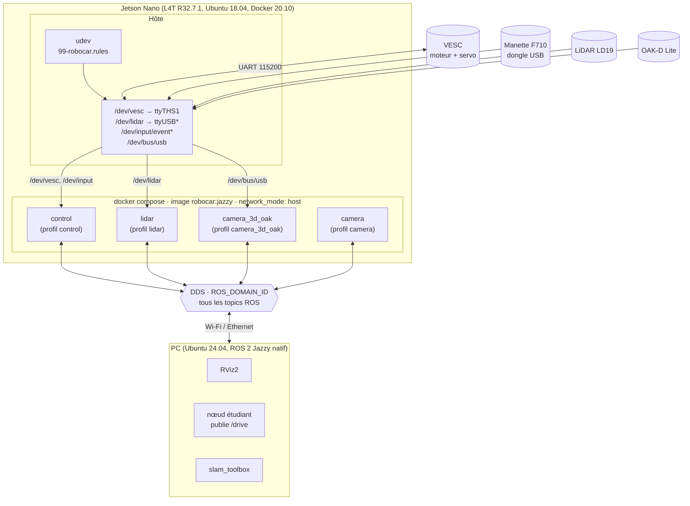

Trois idées à retenir :

1. **Même image, plusieurs conteneurs.** On construit une fois (`docker compose build control`), et tous les services réutilisent `robocar:jazzy`. Seule la commande lancée change (`ros2 launch robocar_bringup <brique>.launch.py`).
2. **Réseau `host` et `ipc: host`.** Les conteneurs n'ont pas de réseau à eux : ils partagent celui de la Jetson. Les nœuds ROS de tous les conteneurs et du PC se trouvent donc par la découverte DDS normale, comme s'ils tournaient directement sur la machine. `ipc: host` permet la mémoire partagée entre conteneurs.
3. **Le matériel est donné au cas par cas.** Chaque conteneur ne voit que les périphériques listés pour lui dans `compose.yaml`. Seul `control` peut parler au VESC et à la manette.

---

## 2. L'image : ce qu'il y a dedans

`docker/Dockerfile`, construit **sur la Jetson** (arm64). Chaque étape est une couche ; Docker garde en cache celles qui n'ont pas changé.

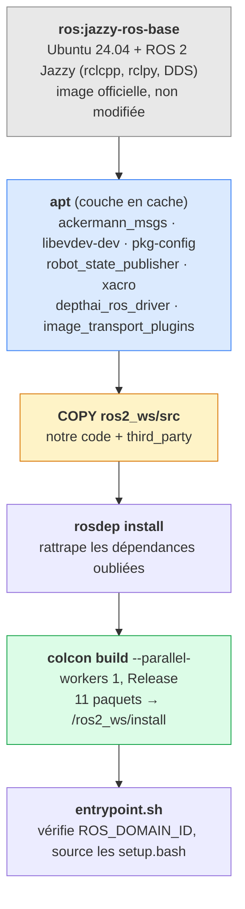

Modifier du code ne refait que les couches à partir de `COPY` : la couche `apt`, la plus longue à télécharger, reste en cache.

Les 11 paquets compilés, et le conteneur qui s'en sert :

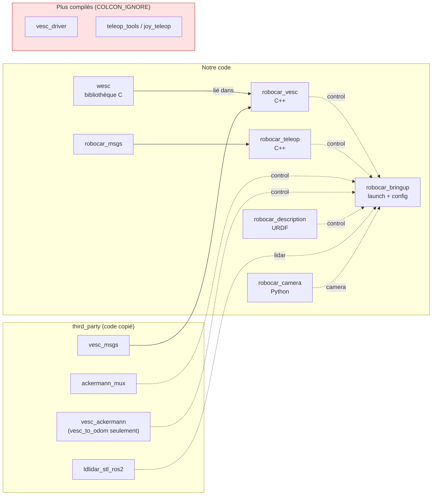

`wesc` n'est pas un nœud : c'est une bibliothèque statique (`libwesc.a`), compilée **dans** l'exécutable `robocar_vesc_node`. Elle ne dépend pas de ROS, et peut toujours se compiler seule avec son `Makefile` (comme dans `le_loto`).

---

## 3. Démarrage d'un conteneur

Tous les conteneurs démarrent de la même façon :

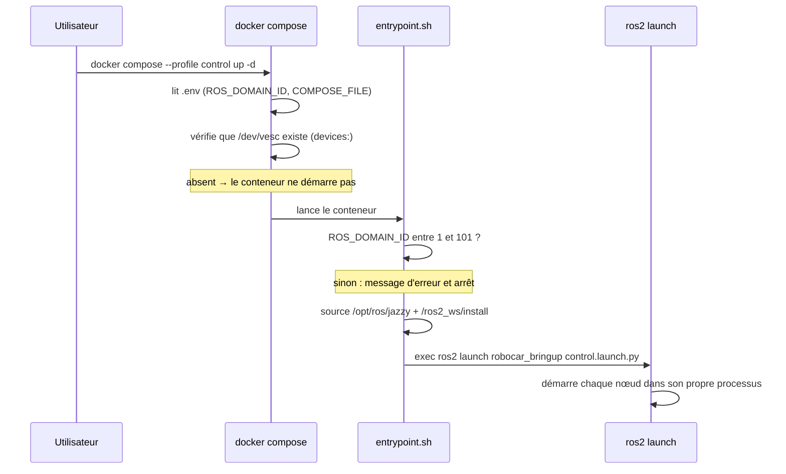

`exec` remplace le shell par `ros2 launch` : c'est lui qui reçoit le `SIGTERM` de `docker compose down` et le transmet aux nœuds, qui s'arrêtent proprement (pour `robocar_vesc` : moteur à 0 et servo au neutre).

Pas de redémarrage automatique (`restart: "no"`), même au démarrage de la Jetson : un conteneur arrêté reste arrêté.

---

## 4. Conteneur `control`

C'est le seul qui touche aux moteurs. Il lance **5 nœuds**, chacun dans **son propre processus** :

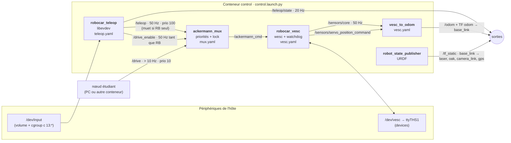

### 4.1 `robocar_teleop` : de la manette à `/teleop`

Lit la F710 **directement dans le fichier** `/dev/input/by-id/*F710*-event-joystick`, avec libevdev. Pas de SDL, pas de nœud `joy`, pas de topic `/joy` : un seul processus au lieu de deux.

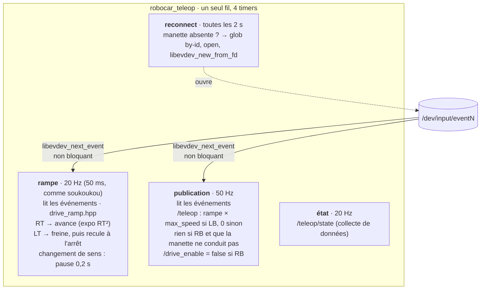

Mapping jeu de voiture : RT avance, LT freine puis recule une fois arrêté. La logique est dans `drive_ramp.hpp`, testée sans manette :

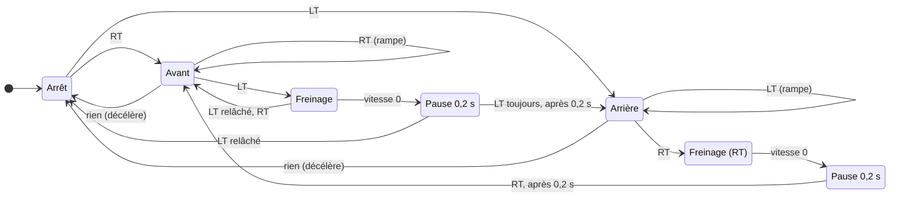

Avec `require_deadman: true` (défaut), tout ceci n'agit que LB maintenu ; relâcher LB ramène à « Arrêt » d'un coup. Avec `false`, RT et LT suffisent, comme dans un jeu.

- **Tout dans un fil.** Les 4 timers tournent dans le même exécuteur ROS : jamais deux callbacks en même temps, donc pas de verrou.
- **libevdev garde l'état.** Le nœud vide la file d'événements, puis demande à libevdev la valeur courante de chaque bouton et axe. Si des événements sont perdus (`SYN_DROPPED`), libevdev resynchronise.
- **Manette perdue** (`ENODEV`) : le fichier est fermé, **plus rien n'est publié**, et le timer `reconnect` la cherche toutes les 2 s. Le volume `/dev/input` et la règle `c 13:* rmw` permettent de rouvrir le nouveau `eventN` après un rebranchement, sans redémarrer le conteneur.

### 4.2 `ackermann_mux` : qui a le droit de conduire

Inchangé par rapport à la version F1TENTH (`mux.yaml`). Il choisit la source de plus haute priorité encore active, et la recopie sur `/ackermann_cmd` :

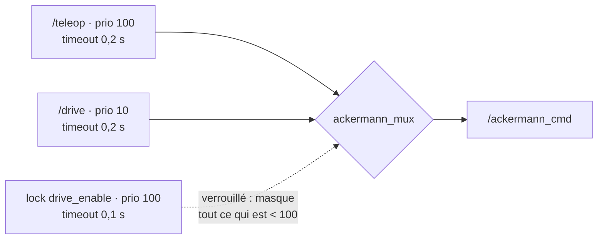

| Boutons | `/teleop` (100) | lock `drive_enable` | Ce qui sort sur `/ackermann_cmd` |
|---|---|---|---|
| Rien | publié, vitesse 0 | verrouillé | `/teleop` à 0 : arrêt, même si `/drive` est publié |
| LB (+ RT / LT) | publié, rampe | verrouillé | `/teleop` : conduite manuelle |
| RB | **muet** | ouvert | `/drive` (après expiration de `/teleop`, 0,2 s) : le nœud étudiant conduit |
| RB + LB | publié, rampe | ouvert | `/teleop` (100 > 10) : la manette reprend la main |
| Manette perdue | muet | verrouillé (expiré) | rien → watchdog de `robocar_vesc` |

Avec `require_deadman: false`, « LB » se lit « une gâchette enfoncée, ou la voiture pas encore arrêtée ».

Le point clé : quand RB est maintenu seul, `robocar_teleop` **arrête de publier `/teleop`**. Sinon `/teleop`, même à vitesse 0, garderait la priorité 100 et `/drive` ne passerait jamais. C'est ce que faisait le profil `default` de `joy_teleop`, inactif dès qu'un bouton est maintenu.

> Le comportement exact du mux (priorités égales, lock) est celui mesuré sur la version F1TENTH (10/10 dans `A_FAIRE_SUR_LA_JETSON.md`). Il est à remesurer avec `robocar_teleop` (`docs/WESC_DOCKER.md` §6).

### 4.3 `robocar_vesc` : de `/ackermann_cmd` au VESC

Le seul processus qui ouvre `/dev/vesc`. Tout se passe dans **un seul timer à 50 Hz** ; le callback `/ackermann_cmd` ne fait que noter la consigne et son heure (horloge monotone).

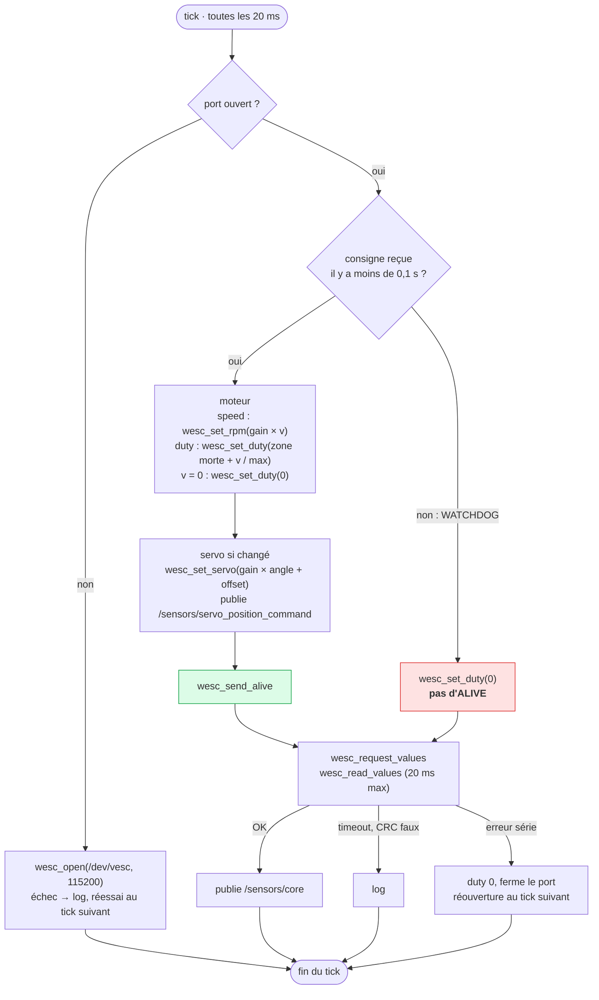

Pourquoi « pas d'`ALIVE` » sans consigne : le VESC coupe le moteur seul s'il ne reçoit plus rien d'utile pendant **500 ms** (son propre timeout). En n'envoyant `ALIVE` que s'il a une consigne fraîche, `robocar_vesc` laisse ce dernier filet fonctionner : si le nœud se bloque ou meurt, le VESC s'arrête de lui-même. C'est la différence principale avec soukoukou, dont un processus fils envoyait `ALIVE` en continu, même si le programme principal était bloqué.

### 4.4 `wesc` : ce qui passe sur le fil

Chaque commande est une **trame** courte. Exemple pour `wesc_set_duty(fd, 0.06)` :

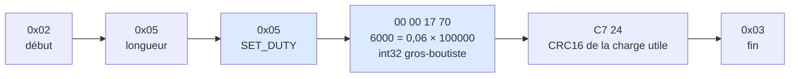

| Fonction | Commande VESC | Charge utile |
|---|---|---|
| `wesc_send_alive` | `ALIVE` (30) | — |
| `wesc_set_duty` | `SET_DUTY` (5) | duty × 100000, int32 |
| `wesc_set_rpm` | `SET_RPM` (8) | ERPM, int32 |
| `wesc_set_servo` | `SET_SERVO_POS` (12) | position × 1000, int16 |
| `wesc_set_current`, `wesc_set_brake` | 6, 7 | ampères × 1000, int32 |
| `wesc_request_values` | `GET_VALUES` (4) | — ; réponse de 73 octets décodée par `wesc_read_values` |

À la lecture, `wesc` attend avec `poll()` jusqu'à un délai maximal, ignore les octets parasites avant un début de trame, et vérifie le CRC et l'octet de fin.

Un tick complet de `robocar_vesc`, consigne active, sur le fil (environ 30 octets dans chaque sens, sur les 230 que permet 115200 bauds en 20 ms) :

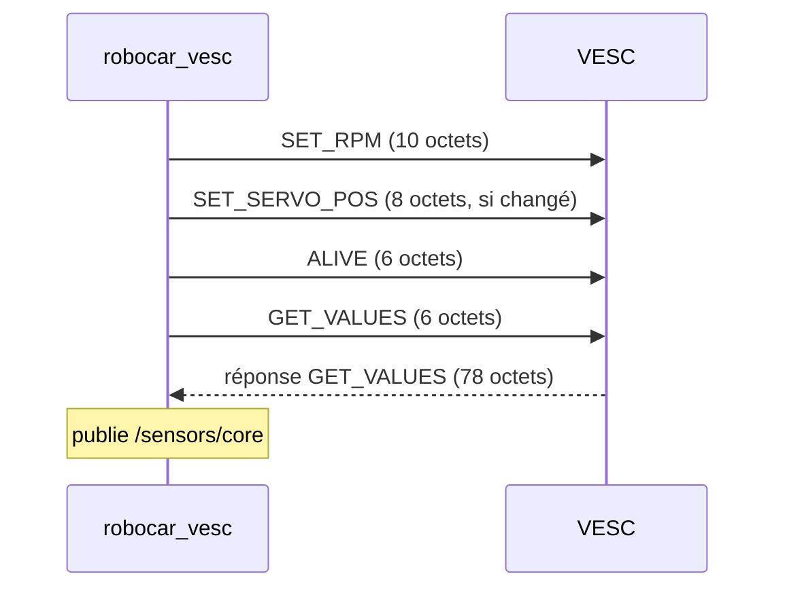

### 4.5 `vesc_to_odom` et `robot_state_publisher`

- **`vesc_to_odom`** (F1TENTH, inchangé) : lit la vitesse mesurée (`/sensors/core`, ERPM ÷ `speed_to_erpm_gain`) et l'angle du servo (`/sensors/servo_position_command`), intègre, et publie `/odom` et la TF `odom → base_link`. Comme `robocar_vesc` publie les mêmes topics et types que `vesc_driver`, il n'a pas eu besoin d'être modifié.
- **`robot_state_publisher`** : lit l'URDF (`robocar_description`) et publie les TF fixes des capteurs.

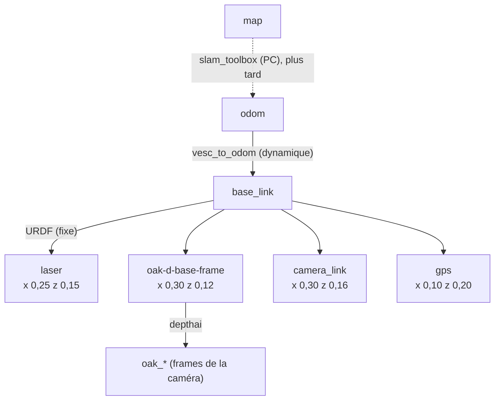

### 4.6 La chaîne de sécurité de bout en bout

Ce qui arrête la voiture, selon ce qui tombe en panne :

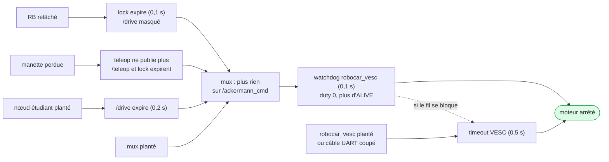

Délais visés : moins de 0,2 s pour les pannes de la manette, du nœud étudiant et du mux ; 0,5 s au plus si `robocar_vesc` meurt. **À mesurer sur la voiture** (`docs/WESC_DOCKER.md` §6).

---

## 5. Conteneur `lidar`

Un seul nœud, code tiers (`ldlidar_stl_ros2`), inchangé par la version wesc.

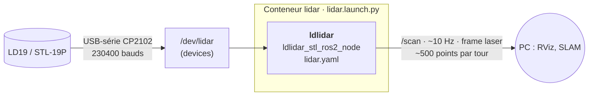

- La TF `base_link → laser` ne vient **pas** de ce conteneur, mais de `robot_state_publisher` dans `control`. Sans `control`, prendre `laser` comme Fixed Frame dans RViz.
- Le LiDAR et le VESC sont dans **des conteneurs séparés** : on peut redémarrer l'un sans couper l'autre, et un plantage du pilote LiDAR n'atteint pas la conduite.

---

## 6. Conteneur `camera_3d_oak`

Pilote officiel Luxonis (`depthai_ros_driver`, installé par apt), inchangé.

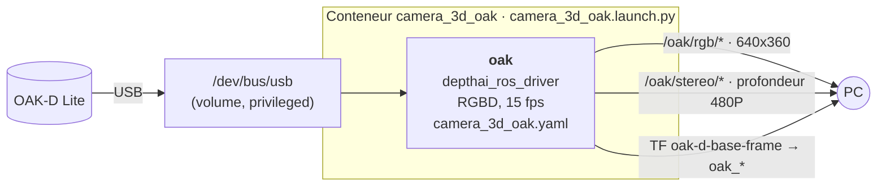

`privileged` et tout `/dev/bus/usb` : au démarrage, la caméra change d'identifiant USB (chargeur d'amorçage, puis application). Un seul `devices:` ne suivrait pas ce changement.

---

## 7. Conteneur `camera`

Squelette d'un nœud caméra générique (`robocar_camera`, Python), **pas encore écrit** : il démarre mais ne publie rien.

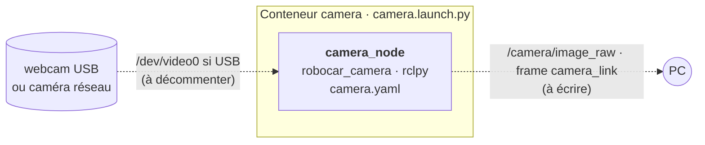

---

## 8. Récapitulatif des conteneurs

| Conteneur | Profil | Nœuds | Accès matériel | Publie |
|---|---|---|---|---|
| `control` | `control` | `robocar_teleop`, `ackermann_mux`, `robocar_vesc`, `vesc_to_odom`, `robot_state_publisher` | `/dev/vesc` (devices), `/dev/input` (volume + cgroup `c 13:*`) | `/teleop`, `/drive_enable`, `/teleop/state`, `/ackermann_cmd`, `/sensors/*`, `/odom`, `/tf`, `/tf_static` |
| `lidar` | `lidar` | `ldlidar` | `/dev/lidar` (devices) | `/scan` |
| `camera_3d_oak` | `camera_3d_oak` | `oak` (depthai) | `/dev/bus/usb` (privileged) | `/oak/rgb/*`, `/oak/stereo/*` |
| `camera` | `camera` | `camera_node` | aucun pour l'instant | rien pour l'instant |

Communs à tous : image `robocar:jazzy`, `network_mode: host`, `ipc: host`, `restart: "no"`, variables de `.env` (`ROS_DOMAIN_ID`, `ROS_AUTOMATIC_DISCOVERY_RANGE`).

---

## 9. Pourquoi c'est plus léger que la version F1TENTH

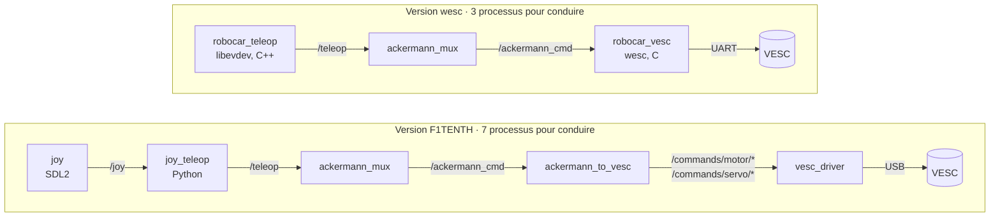

| | F1TENTH | wesc |
|---|---|---|
| Sauts DDS entre la manette et le VESC | 4 | 2 |
| Lecture de la manette | SDL2, par `joy` (dépend de la base udev, absente du conteneur) | `read()` sur `/dev/input/eventN`, par libevdev |
| Protocole VESC | `vesc_driver` (C++, `serial_driver`, `asio`) | `wesc` (C, ~400 lignes, `write()` / `poll()`) |
| Liaison VESC | micro-USB (connecteur fragile) | UART du J41 |
| Dépendances apt retirées | — | `ros-jazzy-joy`, `ros-jazzy-serial-driver`, `ros-jazzy-asio-cmake-module` |

Le mux reste un saut DDS de plus : on l'a gardé pour ne pas réécrire une chaîne de sécurité déjà mesurée (`docs/WESC_JAZZY.md` §1).
