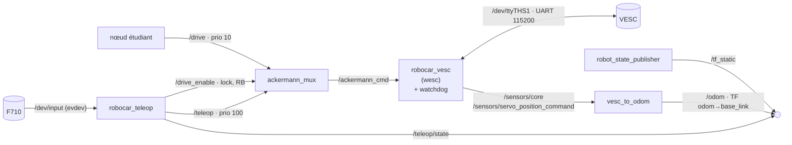

# Robocar ROS 2 + wesc : conception

Version de `Robocar_ROS2` où la brique `control` n'utilise plus le driver VESC de F1TENTH (`vesc_driver`, `ackermann_to_vesc`) ni `joy` / `joy_teleop`. Elle utilise nos bibliothèques, déjà éprouvées sur la voiture hors ROS (`~/le_loto` sur la Jetson) :

- **`wesc`** : protocole VESC réécrit en C (à la place de pyvesc), par le port série matériel de la Jetson ;
- **la gestion manette de `soukoukou`** (`le_loto/RoboCar`) : courbe d'accélération, rampes, frein proportionnel, inversion de sens.

Le reste ne change pas : image `ros:jazzy-ros-base`, un service `docker compose` par brique, `lidar`, `camera_3d_oak`, `camera`, l'interface étudiants (`/drive`, `/odom`, `/scan`) et l'arbitrage par `ackermann_mux`.

> **État : documentation seulement.** Aucun paquet n'est écrit. Les dossiers `ros2_ws/src/wesc`, `robocar_vesc`, `robocar_teleop` et `robocar_msgs` contiennent seulement un `README.md` (sans `package.xml`, colcon les ignore). Le plan est au §9.

## 1. Décisions

| Sujet | Décision | Pourquoi |
|---|---|---|
| Liaison VESC | **UART matériel `/dev/ttyTHS1`, 115200 bauds** (broches 8/10 du J41), plus l'USB | Le micro-USB du VESC est peu fiable (connecteur fragile, déconnexions). Le VESC a déjà `permanent_uart_enabled = 1` et `app_uart_baudrate = 115200` (`host/vesc/vesc_appconf.xml`) : rien à changer côté VESC |
| Protocole VESC | **`wesc`** (C), dans le conteneur | Notre code, déjà validé sur la voiture avec `soukoukou`. Remplace `vesc_driver` et `ackermann_to_vesc` |
| Manette | **`robocar_teleop`**, lecture directe par libevdev | Reprend la logique de `soukoukou`. Remplace `joy` + `joy_teleop` (SDL). libevdev gère aussi le rebranchement du dongle |
| Arbitrage | **`ackermann_mux` conservé** (`third_party/`) | Même priorités et même lock `drive_enable` : l'interface étudiants et la chaîne de sécurité ne changent pas |
| Odométrie | **`vesc_to_odom` conservé** (`third_party/vesc/vesc_ackermann`) | `robocar_vesc` publie les mêmes topics que `vesc_driver` (`/sensors/core`, `/sensors/servo_position_command`), avec `vesc_msgs` |
| Image de base | **`ros:jazzy-ros-base`, inchangée** | On ne « forke » pas l'image Docker : on change ce qu'on construit dessus (`Dockerfile`, `ros2_ws/src`) |
| Sécurité (watchdog, homme mort) | **Documentée ici (§6), implémentée plus tard** | Choix de l'équipe. **Bloquant avant tout essai moteur** |

## 2. Graphe des nœuds (brique `control`)



Comparaison avec la version F1TENTH (`ARCHITECTURE.md` du dépôt amont) :

| Version F1TENTH | Notre version | Statut |
|---|---|---|
| `joy` (SDL) | — | Retiré : `robocar_teleop` lit `/dev/input` lui-même |
| `joy_teleop` | `robocar_teleop` | Remplacé |
| `ackermann_mux` | `ackermann_mux` | Conservé, config inchangée |
| `ackermann_to_vesc` (+ watchdog `[robocar]`) | `robocar_vesc` | Remplacé (conversion m/s → ERPM et watchdog intégrés) |
| `vesc_driver` (USB `/dev/vesc`) | `robocar_vesc` (UART `/dev/ttyTHS1`) | Remplacé |
| `vesc_to_odom` | `vesc_to_odom` | Conservé |
| `vesc_msgs` | `vesc_msgs` | Conservé (types des topics `/sensors/*`) |

## 3. Paquets

```
ros2_ws/src/
├── wesc/              bibliothèque C (ament_cmake), aucune dépendance ROS
├── robocar_msgs/      messages : TeleopState
├── robocar_vesc/      nœud : /ackermann_cmd → wesc → VESC, télémétrie → /sensors/*
├── robocar_teleop/    nœud : F710 (libevdev) → /teleop, /drive_enable, /teleop/state
├── robocar_bringup/   launch + config (control.launch.py réécrit)
├── robocar_description/, robocar_camera/   inchangés
└── third_party/
    ├── ackermann_mux/        conservé
    ├── vesc/vesc_msgs/       conservé
    ├── vesc/vesc_ackermann/  conservé pour vesc_to_odom (ackermann_to_vesc n'est plus lancé)
    ├── vesc/vesc_driver/     COLCON_IGNORE (plus compilé)
    ├── vesc/vesc/            COLCON_IGNORE (métapaquet)
    ├── teleop_tools/         COLCON_IGNORE en entier (joy_teleop retiré)
    └── ldlidar_stl_ros2/     inchangé
```

Détails de chaque paquet : son `README.md`.

### `wesc` (C, ament_cmake)

Copie de `le_loto/wesc` (origine notée dans `ros2_ws/src/wesc/README.md`). Changements prévus pour en faire une bibliothèque réutilisable :

1. **Couche série dans la bibliothèque.** `wesc.h` déclare `init()`, `set_term()` et `send_alive()`, mais ils sont implémentés dans `RoboCar/src/control/tty.c`, pas dans `wesc`. Les déplacer dans `wesc/src/tty.c`, avec un débit en paramètre.
2. **Préfixe `wesc_`** sur les symboles publics (`init`, `alive`, `crc16`, `cmd_list` sont des noms trop génériques, risque de collision au link).
3. **`extern "C"`** dans `wesc.h`, pour l'appeler depuis un nœud C++ (`rclcpp`).
4. **Plus de `fork()` pour `ALIVE`** : c'est l'appelant (le nœud) qui envoie `ALIVE` depuis sa boucle (§6).
5. **Lecture avec timeout** : `read_packet` bloque indéfiniment si le VESC ne répond pas. Ajouter un `poll()` avec délai, et une resynchronisation sur l'octet de début `0x02`.
6. **Valeurs en unités VESC explicites** : `wesc_set_duty(fd, float)` (−1..1), `wesc_set_rpm(fd, int32 erpm)`, `wesc_set_servo(fd, float)` (0..1), `wesc_set_current(fd, float A)`, `wesc_set_brake(fd, float A)`. Les macros `WRITE_*` actuelles restent comme alias pour `le_loto`.
7. Compilé en bibliothèque statique `libwesc.a`, en-têtes installés, exportée par `ament_export_targets` (`find_package(wesc)` dans les autres paquets).

La bibliothèque doit rester utilisable hors ROS : `le_loto/RoboCar` peut la compiler avec son `Makefile`.

### `robocar_vesc` (C++, rclcpp)

| Entrée / sortie | Topic | Type |
|---|---|---|
| Entrée | `ackermann_cmd` | `ackermann_msgs/AckermannDriveStamped` |
| Sortie | `sensors/core` | `vesc_msgs/VescStateStamped` (depuis `GET_VALUES`) |
| Sortie | `sensors/servo_position_command` | `std_msgs/Float64` (pour `vesc_to_odom`) |

Deux modes moteur, paramètre `motor_mode` :

| Mode | Commande VESC | Usage |
|---|---|---|
| `speed` (défaut) | `SET_RPM`, ERPM = `speed_to_erpm_gain` × vitesse + offset | `/drive` des étudiants, odométrie cohérente |
| `duty` | `SET_DUTY_CYCLE`, duty = vitesse / `max_speed` × `duty_max`, avec saut de la zone morte (`duty_deadband`, 6 % mesuré) | Reprend le comportement éprouvé de `soukoukou` (moteur sans capteur, saccadé à basse vitesse en mode RPM) |

Direction : `servo = steering_angle_to_servo_gain × angle + offset`, borné à `[servo_min, servo_max]` (mêmes valeurs que `vesc.yaml`).

Paramètres : ceux de `vesc.yaml` (gains, bornes, `cmd_timeout`), plus `port` (`/dev/ttyTHS1`), `baud` (115200), `motor_mode`, `duty_max`, `duty_deadband`, `invert_motor`, `telemetry_rate` (Hz).

### `robocar_teleop` (C++, rclcpp + libevdev)

Reprend la logique de `le_loto/RoboCar/src/control/speed.c`, mais elle produit une **consigne ROS** au lieu d'écrire sur le VESC :

| Fonction de `soukoukou` | Dans `robocar_teleop` |
|---|---|
| `speed_control` : gâchette R2 0..255 → expo (`THROTTLE_CURVE` 2,0) | Même calcul, en fraction de `max_speed` |
| `update_speed` : rampe lente à l'accélération, rapide au freinage, passage par zéro | Même rampe, en m/s/tick, timer à 20 Hz (50 ms comme `SPEED_STEP`) |
| `brake_control` : L2 proportionnel | Identique |
| `change_direction` (R1) | **Déplacé sur un autre bouton** : RB sert déjà au lock `drive_enable` (§5) |
| Pause au point mort à l'inversion (`CROSS_HOLD_TICKS`) | Identique |
| Saut de la zone morte (`THROTTLE_DEADBAND`) | **Déplacé dans `robocar_vesc`** (mode `duty`) : c'est une propriété du moteur, pas de la manette |
| `servo_control` : stick gauche X | `steering_angle` = X × `max_steering_angle` (0,34 rad) |
| `action_bridge` (TCP 5008) | Remplacé par le topic `/teleop/state` (§4) |
| Home → `quit()` | Home → consigne nulle (le nœud ne s'arrête pas) |

Sorties : `/teleop` (`AckermannDriveStamped`), `/drive_enable` (`std_msgs/Bool`, publié en continu tant que RB est maintenu), `/teleop/state` (`robocar_msgs/TeleopState`).

Manette : chemin `by-id` en paramètre (`device`), relecture toutes les 2 s si absente (comme `get_controller_dev`).

### `robocar_msgs`

`TeleopState.msg` : `header`, `throttle` et `steer` bruts (−1..1, + = avant / droite, même formule que l'`action_bridge`), `direction` (avant / arrière), `braking`, `manual_enabled` (LB), `drive_enabled` (RB). Sert à la collecte de données (`real_car_client.py` du dépôt LIAM, à porter en `rclpy`).

## 4. Topics

| Topic | Type | Publié par |
|---|---|---|
| `/drive` | `ackermann_msgs/AckermannDriveStamped` | nœud étudiant (> 10 Hz, RB maintenu) |
| `/teleop` | `ackermann_msgs/AckermannDriveStamped` | `robocar_teleop` (LB) |
| `/drive_enable` | `std_msgs/Bool` | `robocar_teleop` (RB) |
| `/teleop/state` | `robocar_msgs/TeleopState` | `robocar_teleop` |
| `/ackermann_cmd` | `ackermann_msgs/AckermannDriveStamped` | `ackermann_mux` |
| `/sensors/core` | `vesc_msgs/VescStateStamped` | `robocar_vesc` |
| `/sensors/servo_position_command` | `std_msgs/Float64` | `robocar_vesc` |
| `/odom` | `nav_msgs/Odometry` | `vesc_to_odom_node` |

Les topics `/commands/motor/*` et `/commands/servo/position` de la version F1TENTH disparaissent : `robocar_vesc` reçoit directement `/ackermann_cmd`. `tests/test_safety_chain.py` les écoute : il faudra l'adapter (§9).

## 5. Manette F710 (proposition, à valider)

| Commande | F1TENTH (`joy_teleop`) | `soukoukou` | **Notre version** |
|---|---|---|---|
| Homme mort conduite manuelle | LB maintenu | — | **LB maintenu** |
| Accélérer | stick gauche vertical | R2 (gâchette) | **R2**, avec expo et rampe |
| Freiner | — | L2 | **L2**, proportionnel |
| Direction | stick droit horizontal | stick gauche horizontal | **stick gauche horizontal** |
| Avant / arrière | signe du stick | R1 (bascule) | **Y** (`BTN_WEST`, bascule) |
| Déverrouiller `/drive` | RB maintenu | — | **RB maintenu** (inchangé) |
| Arrêt | relâcher LB | Home (quitte) | relâcher LB, ou **Home** (consigne nulle) |

Les boutons Triangle / Carré / Croix de l'ancien lanceur (`binary/init` : `drive.sh`, `liam.sh`, `camera.sh`) **n'existent plus** dans cette version : chaque brique est un service `docker compose`. L'ancien lanceur doit être désactivé (crontab root) avant toute utilisation de `control`, sinon deux programmes ouvrent la manette et le VESC.

## 6. Sécurité (à implémenter plus tard, bloquant avant un essai moteur)

La version actuelle de `soukoukou` n'a pas de watchdog : `ALIVE` est envoyé par un processus fils (`fork`) indépendant. Si le programme principal se bloque, le fils continue d'envoyer `ALIVE`, le timeout du VESC (500 ms) ne se déclenche jamais, et **le dernier duty reste appliqué**.

Exigences pour `robocar_vesc`, pour retrouver la chaîne de sécurité de `ARCHITECTURE.md` :

1. **Un seul fil** envoie les commandes et `ALIVE`. Si ce fil se bloque, plus rien n'arrive au VESC, et son timeout de 500 ms coupe le moteur.
2. **`cmd_timeout` (0,1 s, horloge monotone)** : sans message sur `ackermann_cmd`, consigne moteur nulle (comme le patch `[robocar]` de `ackermann_to_vesc`, `third_party/VENDORED.md`).
3. **`ALIVE` seulement si une consigne valide est active.** Sinon, on laisse le timeout du VESC agir.
4. À l'arrêt du nœud (`SIGINT`, `SIGTERM`, destruction) : duty 0, puis fermeture du port.
5. Erreurs série (lecture ou écriture) : consigne nulle, log, tentative de réouverture.

Pour `robocar_teleop` : `/teleop` et `/drive_enable` publiés à 50 Hz (comme `autorepeat_rate`), et rien du tout si la manette disparaît. Le mux masque alors `/drive` en 0,1 s, puis le watchdog met la vitesse à 0.

Tests à refaire, roues en l'air : le tableau de `ARCHITECTURE.md` (§ Chaîne de sécurité), plus « `robocar_vesc` tué » et « câble UART débranché ».

## 7. Matériel et hôte

- **Câblage UART** : VESC TX → Jetson RX (J41 broche 10), VESC RX → Jetson TX (J41 broche 8), masse commune (broche 6). Niveaux 3,3 V des deux côtés. Pas de 5 V entre les deux.
- **`/dev/ttyTHS1`** appartient à `root:dialout` (0660). Le conteneur tourne en root : `devices: - /dev/ttyTHS1` suffit.
- **Règle udev** (`host/99-robocar.rules`) : ajouter `KERNEL=="ttyTHS1", SYMLINK+="vesc", MODE="0660", GROUP="dialout"`, et retirer la règle USB `0483:5740 → vesc`, pour garder le nom `/dev/vesc` partout. Ne pas brancher l'USB du VESC en même temps.
- **Console série** : vérifier qu'aucun `getty` n'écoute `ttyTHS1` (`systemctl status nvgetty`, `cat /proc/cmdline | grep console`). Sur la Nano, la console est normalement sur `ttyS0`.
- **VESC Tool** : aucun changement. `permanent_uart_enabled` est déjà à 1 et le débit à 115200. Le timeout de 500 ms reste le dernier filet.
- **Sens du moteur** : `soukoukou` utilise « duty négatif = avant », alors que `host/vesc/README.md` note « consigne positive = avant » sous ROS. À vérifier roues en l'air, puis régler `invert_motor`.

## 8. Docker

- `docker/Dockerfile` : retirer `ros-jazzy-joy` et `ros-jazzy-serial-driver` (utilisé seulement par `vesc_driver`), ajouter `libevdev-dev`.
- `docker/compose.yaml`, service `control` :
  ```yaml
  devices:
    - /dev/vesc            # -> ttyTHS1 par udev
  volumes:
    - /dev/input:/dev/input   # rebranchement du dongle F710
  device_cgroup_rules:
    - 'c 13:* rmw'
  ```
  `SDL_JOYSTICK_DISABLE_UDEV` n'est plus utile (plus de SDL).
- Image toujours construite sur la Jetson, `colcon build --parallel-workers 1`.

## 9. Plan

| Étape | Contenu | Vérification |
|---|---|---|
| 1 | `wesc` en paquet ament (§3), tests unitaires sans matériel : CRC, encodage de chaque commande, décodage d'un `GET_VALUES` enregistré | `colcon test` sur le PC |
| 2 | `robocar_msgs` | build |
| 3 | `robocar_vesc` sans moteur : télémétrie seule (`GET_VALUES`) sur `/dev/ttyTHS1` | `/sensors/core` publie la tension |
| 4 | `robocar_teleop` | `/teleop`, `/drive_enable`, `/teleop/state` corrects, avec et sans LB / RB |
| 5 | Sécurité (§6) dans `robocar_vesc` et `robocar_teleop` | tests du §6, sans moteur, puis `tests/test_safety_chain.py` adapté |
| 6 | `control.launch.py`, `Dockerfile`, `compose.yaml`, udev, `COLCON_IGNORE` sur les paquets retirés | build de l'image sur la Jetson |
| 7 | Roues en l'air : sens du moteur, direction, modes `speed` et `duty`, chaîne de sécurité complète | tableau de `ARCHITECTURE.md` |
| 8 | Docs étudiants : `README.md` §3, §4, §6 (manette, dépannage `/dev/vesc`), `BOOTSTRAP.md` §3 (câblage UART) | relecture |

## 10. Différences avec `le_loto` à garder en tête

- `soukoukou` écrit sur le VESC toutes les 50 ms **même sans changement** de consigne. `robocar_vesc` envoie à la fréquence d'`ackermann_cmd` (≥ 10 Hz), plus `ALIVE`.
- `soukoukou` est seul sur le VESC. Ici, un seul nœud (`robocar_vesc`) ouvre le port. Tout autre programme (VESC Tool par l'UART, `le_loto`) doit être arrêté.
- La rampe et l'expo étaient en unités de duty (±100000 = 100 %, `MAX_SPEED` = 20000 soit 20 %). Ici, elles sont en m/s. Les valeurs de départ sont converties dans `robocar_teleop/README.md`.
